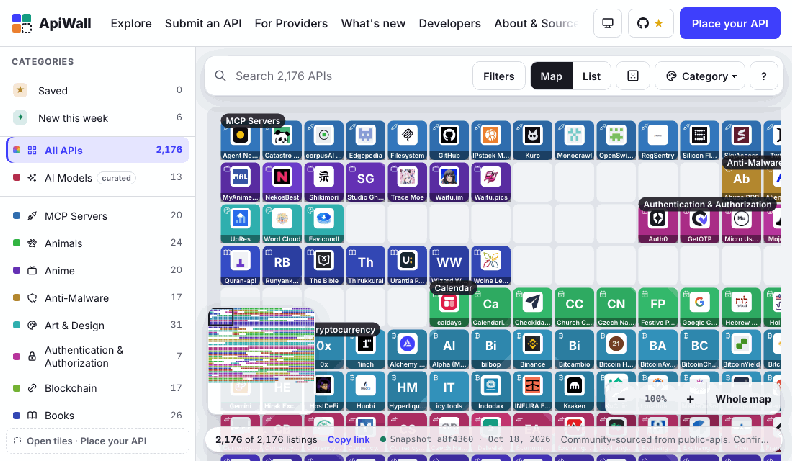
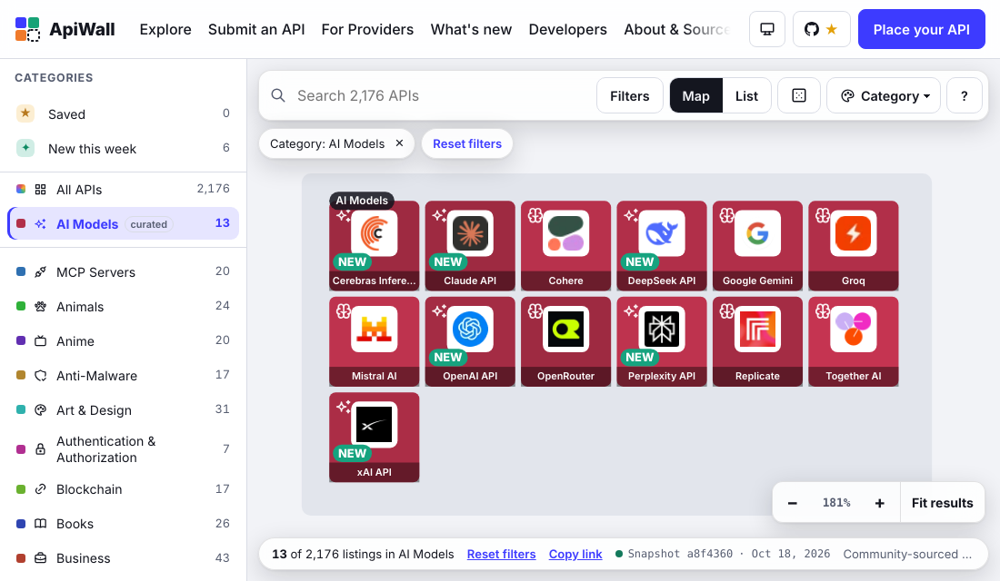
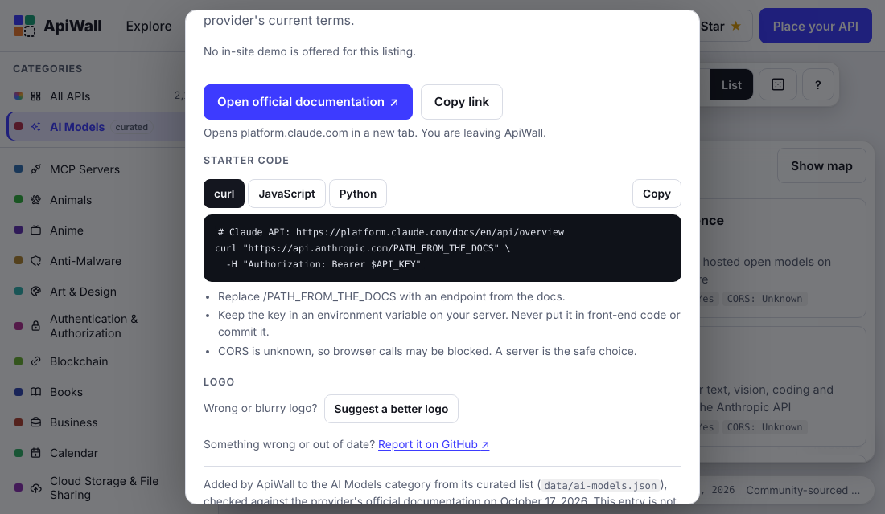
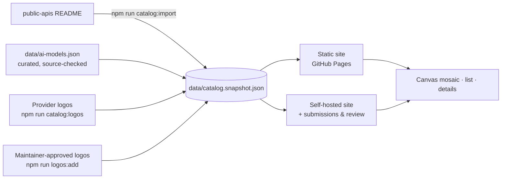

<div align="center">

# ApiWall

**Every public API on one zoomable wall.**
Search 2,150+ APIs, 20 MCP servers and a curated list of AI model APIs, filter by category or
auth, and open the docs in a click.

[**🌐 Open the live wall**](https://eziodevio.github.io/ApiWall/) ·
[Add an API](https://github.com/EzioDEVio/ApiWall/issues/new?template=add-api.yml) ·
[Suggest a logo](https://github.com/EzioDEVio/ApiWall/issues/new?template=suggest-logo.yml)

[](https://github.com/EzioDEVio/ApiWall/actions/workflows/ci.yml)
[](https://github.com/EzioDEVio/ApiWall/actions/workflows/pages.yml)
[](LICENSE)


   

</div>

## Why it's fun to use

- **A wall you can fly over.** Every API is a tile on one large map. Scroll, drag or pinch to move;
  zoom from the whole wall down to logos and names.
- **Categories that really filter.** Pick a category, or **AI Models**, and only those tiles
  remain, packed together and fitted to your screen. Search and filters work the same way.
- **Color lenses.** Recolour the whole wall by auth, HTTPS, CORS or logo and see at a glance where
  the keyless or browser-friendly APIs are. Click a colour in the legend to show only those.
- **Instant suggestions.** Start typing and the best matches appear with their logos; arrow keys
  and Enter jump straight to one.
- **Details beside the map.** On wide screens an API opens in a side panel, and ‹ › (or the
  arrow keys) step through the results without losing your place.
- **Surprise me.** Press <kbd>R</kbd> (or the dice) to open a random API from what you're viewing.
- **Light or dark.** Follows your system, or pick one with the toggle in the header.
- **Starter code.** Each API shows copy-ready `curl`, JavaScript and Python with the right auth
  header. Keys stay in environment variables, and endpoints are never made up.
- **Save your favourites.** Star any API (on its card, or ☆ Save in its details) and find it
  under **Saved**. Saved APIs stay in your browser — no account, nothing sent anywhere — and
  **Copy share link** turns them into one link that opens as a shared list anyone can save.
- **New this week.** APIs added by the weekly catalog sync carry a **NEW** badge for seven
  days, and the **What's new** page lists every sync's additions and removals.
- **Links that keep your view.** The address bar always holds the current category, search,
  filters and open API. Copy it, share it, and it opens exactly the same view.
- **Honest data.** Facts come straight from the [public-apis](https://github.com/public-apis/public-apis)
  catalog, every curated AI Models entry is checked against official docs with a date, and
  pricing is shown only when verified.
- **Works everywhere.** Keyboard and screen-reader friendly, no sideways scrolling, and on
  phones a bottom tab bar (Map, List, Categories, Saved) with details that slide up as a sheet
  you swipe down to close.

<table>
<tr>
<td></td>
<td></td>
</tr>
</table>

## Contribute in two minutes

No setup needed. Open a pre-filled form from any tile, or here:

| I want to… | Use |
| --- | --- |
| Add a public API (or my own) | [Add an API](https://github.com/EzioDEVio/ApiWall/issues/new?template=add-api.yml) |
| Give an API its real logo | [Suggest a logo](https://github.com/EzioDEVio/ApiWall/issues/new?template=suggest-logo.yml) |
| Fix a broken link or wrong detail | [Report a listing](https://github.com/EzioDEVio/ApiWall/issues/new?template=report-listing.yml) |

Code contributions are welcome too: see [CONTRIBUTING.md](CONTRIBUTING.md). If you like the
project, a ⭐ helps others find it.

## Quick start

```bash
git clone https://github.com/EzioDEVio/ApiWall.git
cd ApiWall
npm install
npm run dev            # http://localhost:3000
```

The catalog snapshot is committed, so the site works offline. To refresh logos from each
provider's site, run `npm run catalog:logos` (about 3 minutes).

## How it works



- **Stable map.** Each listing has a permanent tile, so refreshes never shuffle the wall.
- **One result set.** Search, category and filters run through one pipeline that drives the map,
  the list and every count.
- **Fast.** One canvas draws only the visible tiles, tiles load small WebP copies of each logo
  (about 6× lighter than the originals), and the browser gets a slimmed-down catalog.

## Two ways to run it

| | GitHub Pages (static) | Self-hosted (Node server) |
| --- | --- | --- |
| Explore, search, filters, details, starter code | ✅ | ✅ |
| Add an API / suggest a logo | GitHub issue forms | Built-in forms with review |
| Reviewer area (`/review`) | — | ✅ |
| Build | `npm run build:static` → `out/` | `npm run build && npm start` |

### Deploy to GitHub Pages

1. Push to `main`.
2. In the repository, open **Settings → Pages → Build and deployment** and set **Source** to **GitHub Actions**.
3. The **Deploy to GitHub Pages** workflow builds the static site and publishes it at
   `https://<owner>.github.io/<repo>/`.

To try the Pages build locally (Windows, macOS or Linux), stop `npm run dev` first, then run
`npm run preview:static` and open http://localhost:4173/ApiWall/.

### Weekly catalog sync

`.github/workflows/catalog-sync.yml` imports the latest catalog every Monday, fetches logos
for new listings and opens a pull request. Enable **Settings → Actions → General → Allow
GitHub Actions to create and approve pull requests** once.

## Commands

| Command | What it does |
| --- | --- |
| `npm run dev` / `npm run build` / `npm start` | Develop, build, serve |
| `npm run build:static` | Static export for GitHub Pages (`out/`); add `-- --base /ApiWall` for a project page |
| `npm run preview:static` | Build like GitHub Pages and serve it at http://localhost:4173/ApiWall/ |
| `npm run lint` · `npm run typecheck` | ESLint · `tsc --noEmit` (strict) |
| `npm test` · `npm run test:e2e` | Vitest unit/component tests · Playwright on desktop and mobile (`npx playwright install chromium` once, `npm run build` first) |
| `npm run catalog:import` | Refresh the catalog snapshot from upstream |
| `npm run catalog:logos` | Download each API's own logo into `public/marks/`, make small tile copies, then rebuild the snapshot |
| `npm run logos:optimize` | Make the small WebP copies tiles use (`public/marks/tiles/`); originals stay untouched |
| `npm run logos:add -- "<name or id>" <image> <https source>` | Commit a maintainer-approved logo (also `logos:remove`, `logos:promote`) |
| `npm run reviewer:setup` | Create reviewer credentials in `.env.local` (self-hosted only) |
| `npm run media:demo` | Record `docs/media/apiwall-demo.gif` from a running site |
| `npm run check:secrets` | Scan source and the built bundle for credentials (run after `build`) |

## Refreshing the catalog

```bash
npm run catalog:import                   # fetch master from GitHub; falls back to the cached README
npm run catalog:import -- --offline      # rebuild from data/upstream/README.md only
npm run catalog:import -- --ref <sha>    # pin an upstream commit
npm run catalog:import -- --readme f.md  # import a local file
```

The importer parses each category table and the separate MCP Servers table, skips
promotional sections, de-duplicates rows, and keeps raw Auth/HTTPS/CORS values verbatim.
Listing IDs come from name + URL, and **placements are carried over from the previous
snapshot**, so existing tiles never move; new listings take free slots in their category
band. If GitHub is unreachable it rebuilds from `data/upstream/README.md`; with no cache
it fails instead of inventing data. Commit the updated `data/` files after a refresh.

Each import also dates listings it has not seen before (`addedAt` in the snapshot) and adds
an entry to `data/changelog.json` with what was added and removed. That file feeds the
**What's new** page and the NEW badges. Listings from the very first import have no date,
because there is no way to know when they joined public-apis.

The JSON service mentioned in the upstream README (`api.publicapis.org`, from
davemachado/public-api) did not respond when checked and is not used.

## Categories, search and the map

One filter pipeline (`lib/explore/model.ts`) produces the visible result set. The map, the
list, the result count, the per-category counts and the details panel all read that same
set. Every active criterion applies together (AND), and categories match by exact slug
(or a curated tag), never by substring.

- **Category list.** A vertical sidebar on wide windows; below 900 px it becomes a drawer
  opened from the **Categories** button. **All APIs** and **AI Models** stay pinned at the
  top. Each row shows how many results choosing it would give with the other filters.
- **Map.** With nothing filtered, the full map keeps every tile at its stable position.
  With a category, search or filter active, only the matching tiles are drawn, packed into a
  compact grid and fitted to the view. Listing IDs never change. Clearing all filters brings
  the full map back where you left it. Zero matches show an empty state with the query.
- **Active filters** appear as removable chips under the search bar, with **Reset filters**.

## AI Models (curated supplement)

The upstream catalog has no AI Models category, so ApiWall adds one from
`data/ai-models.json`, a small curated list that is kept separate from the upstream data:

- `providers`: model APIs that are not in public-apis (OpenAI, Anthropic, DeepSeek, xAI,
  Perplexity, Cerebras). They are labelled as added by ApiWall, not as catalog entries.
- `crossTags`: public-apis listings that serve generative models (Google Gemini, Mistral AI,
  Cohere, Groq, OpenRouter, Together AI, Replicate). They keep their upstream category
  (Machine Learning) and are also shown under AI Models.
- Each entry records the official docs URL, the models the docs name, the auth method and
  the date it was checked. Free tiers and pricing are **not** verified and show as Unknown.
  `notVerified` lists providers left out because their docs could not be confirmed.

Generic machine-learning tools stay in Machine Learning only. Entries without an https docs
link or a check date are rejected at import. To change the list, edit the file, check each
entry against the provider's docs, then run `npm run catalog:import -- --offline`.

## Logos

The upstream catalog has no logos. To fill tiles with each API's real logo, run this
on a machine with normal internet access (it reads about 2,000 sites and takes a few
minutes):

```bash
npm run catalog:logos                 # fetch missing logos, then rebuild the snapshot
npm run catalog:logos -- --limit 50   # try a small batch first
npm run catalog:logos -- --retry      # retry listings that failed last time
npm run catalog:logos -- --refresh    # re-fetch everything
```

For each listing it reads the provider's own home page and saves the icon that page
declares (largest first), else the site's `/favicon.ico`, else, for GitHub-hosted
projects, the owner's avatar. SVG is never used. Files are checked by their bytes
(PNG, JPEG, WebP, GIF or ICO, 16 px to 4096 px, at most 300 KB) and saved to
`public/marks/`, with the source page and date recorded in `data/favicons.json`. Pages
that belong to a platform rather than the provider (GitHub, RapidAPI, Postman,
Google Docs and similar) are never read, and an icon shared by three or more unrelated
domains is treated as a platform default and dropped. The site serves these files
itself and never loads images from other websites. Each tile's detail panel names
where its logo came from. Commit `public/marks/` and `data/` afterwards.

Without this step, tiles show a Simple Icons brand mark where a defensible one exists
and a generated monogram otherwise.

## Adding missing logos

`npm run catalog:logos` finds a logo for most listings, but some sites publish none it can
use. Logos that should ship with the site are **committed to the repo**: files in
`public/marks/community/`, records in `data/community-logos.json`. They work on GitHub
Pages and the self-hosted site alike, and are labelled "Approved by an ApiWall maintainer"
with their source page.

- **From a GitHub issue** (the static site's "Suggest a logo" button opens one): download the
  image, check it is the provider's own, then run
  `npm run logos:add -- "<listing name or id>" path/to/logo.png https://provider.example/brand`
  and commit.
- **From the self-hosted review area**: visitors can upload suggestions from any listing,
  and reviewers approve them in `/review` → **Logos**, or publish one directly with **Add a
  logo to a listing**. These live in `data/runtime/` on that server; run
  `npm run logos:promote` to copy every approved logo into the repo, then commit.
- `npm run logos:remove -- "<listing name or id>"` takes one out again.

Images must be PNG, JPEG or WebP (checked by their bytes; SVG is refused), up to 256 KB.
In Explore, **Filters → Logo → No logo yet** lists the listings still missing one.

## Reviewer access

The review area (`/review`) and its API are closed unless both variables are set. There
is no built-in password. The quickest setup on your own machine:

```bash
npm run reviewer:setup   # prints a token once; writes only its digest + a session secret to .env.local
```

Restart the server, open `/review` and paste the token. To set the variables yourself instead:

```bash
node -e "const c=require('crypto');const t=c.randomBytes(32).toString('base64url');console.log('token  (give to reviewer):',t);console.log('REVIEWER_TOKEN_SHA256=',c.createHash('sha256').update(t).digest('hex'));console.log('REVIEW_SESSION_SECRET=',c.randomBytes(32).toString('base64url'))"
```

Put the two variables in the server environment (see `.env.example`). Only the token's
SHA-256 is stored; sessions are HMAC-signed, HttpOnly, SameSite=Strict cookies that last
eight hours, and every mutation also requires a same-origin request. Reviewers can
inspect, edit, approve, reject and remove submissions, verify access claims with a source
and date, and see an audit trail.

## Provider submissions

`/submit` collects only what review needs and never asks for keys. Inputs are validated
and stripped to plain text; the contact email must be on the provider's domain;
anything that looks like a credential is refused before anything is stored; a honeypot,
a minimum fill time and rate limits block spam. Uploaded logos must be PNG, JPEG or WebP
(checked by magic bytes, ≤ 256 KB) and are served only after a reviewer approves them.
Submissions stay private until approved. Approved listings appear in the provider band at
the bottom of the map, labelled ◆ Provider-submitted, and ★ Sponsored with a dashed frame
when sponsorship was requested and approved. Sponsorship never changes catalog facts, and
claims on existing catalog entries attach beside the imported values without altering them.

Access claims default to **Unknown**. A claim is shown only after a reviewer records the
provider's source URL, the date checked, limits, eligibility, expiration and terms.

## In-site demos

Disabled. There is no secret manager in this project, so no provider credential can be
stored safely. `/api/demos/*` always returns 404 and forwards nothing, and no "Try demo"
control is rendered. `docs/DEMOS.md` lists what an approved demo would require.

## Self-hosted setup

- **Storage.** Submissions, the audit log and uploaded logos are written to
  `data/runtime/` (or `TESSERA_DATA_DIR`) with atomic file writes. That suits one
  long-running Node server with a persistent disk. Serverless or multi-instance hosting
  needs a database and object storage behind `lib/server/store.ts`.
- **Rate limits** are in memory per process. Behind a reverse proxy, set `TRUST_PROXY=1`
  so limits apply per client IP; without it all clients share one bucket. Multi-instance
  deployments need a shared limiter.
- Security headers, including a CSP that blocks third-party images and scripts, are set
  in `next.config.ts`.

## Tile marks

The catalog has no logos. A brand mark from [Simple Icons](https://simpleicons.org)
(CC0-1.0 icon data; marks remain trademarks of their owners) is shown only when that
project recorded the mark from the listing's own domain or GitHub organisation, the host
is not a shared platform, and the listing name identifies the mark. Every other tile gets
a generated monogram. Category icons are [Tabler Icons](https://tabler.io/icons) (MIT).

## Project map

```
app/                 pages (Explore, Submit, For Providers, What's new, About & Source, Review), API routes, social preview image
components/          Mosaic (canvas), CategoryNav, ListView, DetailDialog, CodeSamples, LogoSuggest, review UI
lib/catalog/         README parser, normalizer, placement, marks, AI Models supplement, community logos, snapshot builder, changelog
lib/explore/         entries, the shared filter pipeline, map layouts, shareable URL state, starter code
lib/logos/           logo suggestions: validation, review rules, public projection
lib/providers/       submission types, validation, review workflow, public projection
lib/server/          file store, rate limiting, reviewer sessions, config
lib/security/        secret detection and redaction
lib/saved.ts         saved APIs, kept in the browser's localStorage
lib/site.ts          site name, repository links, static-mode and base-path settings
scripts/             importer, logo tools, static build, demo recorder, secret scanner
data/                committed snapshot, changelog.json, glyphs, ai-models.json, community-logos.json, upstream README + LICENSE
.github/             CI, Pages deploy, weekly catalog sync, issue forms
docs/media/          README GIF and screenshots
tests/unit, tests/e2e
```

## Dependency audit

`npm audit` reports issues only in development tools, none in code the website runs:

- **Vitest 3.2.7** (test runner) and its `tinypool` dependency. The fixed Vitest 4.1.11+
  cannot currently be installed with npm 10 (an npm bug resolving Vitest 4's optional
  peer packages). These run only when you run `npm test` on your own code.
- **braces**, through the Next.js ESLint plugin. No fixed version has been published; it
  runs only during `npm run lint`.

Fixed: Next.js's internal PostCSS is overridden to 8.5.25, and Playwright is 1.58.2.
Do not run `npm audit fix --force`; it installs breaking major versions.

## License and attribution

Catalog content: MIT License, Copyright (c) 2022 public-apis — see
`data/upstream/LICENSE`. Entries are community-sourced; confirm current documentation,
terms and availability with each provider. A listing does not mean an API is free, live
or safe to call.
